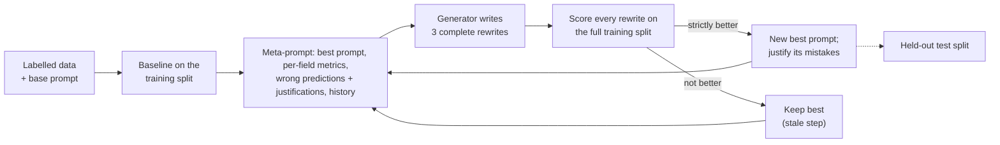

# Whole-Prompt Optimizer

Optimize a prompt against any labelled dataset, on any model provider.

At Leafra I built this engine to tune the vision-language-model prompts that detected falls, bed exits and care activities in senior-living rooms. This repository rebuilds it as a general tool without changing the method. With default settings it builds byte-identical meta-prompts and makes the same scores and accept/reject decisions as the original engine. The only default differences are guards that stop it from hanging forever on errors.

- **Bring** labelled examples (folders, a bucket, or a CSV/JSONL manifest) and a starting prompt. Then pick a candidate model to optimize and a generator model to write new prompts, from any provider.
- **Each step**, the generator sees the current best prompt, every wrong prediction with the model's own explanation, and every prompt tried so far. It writes complete rewrites, and a rewrite is kept only if it scores strictly better on the whole training split.
- **Scored** on balanced accuracy per field, with a held-out test split the search never sees. You also get cost estimates before you start, a live dashboard, and crash-safe resume.



## Quick start

```bash
git clone https://github.com/damondvorson/whole-prompt-optimizer.git
cd whole-prompt-optimizer
npm install
npm start            # http://127.0.0.1:8490
```

You need Node 20.12 or newer, plus `ffmpeg` on your PATH if your dataset has videos. To try the whole loop without an API key, choose **Mock** for both harnesses.

The app has three screens:

1. **Data & prompt.** Drop files or a zip, point at a local folder, or list an S3, GCS or Azure Blob bucket. Tag folders with your own classes (for example `falls` or `bed exit`) and a polarity (positive or negative); tags carry down to subfolders, and `training` / `test` folder names set the split (otherwise a stable hash split is used). You can also map the columns of a CSV, TSV, JSONL or JSON manifest for binary, categorical, number or text labels. Before anything runs, a health report flags duplicate files, train/test leaks and conflicting labels.
2. **Harnesses.** Set the candidate harness (the model being optimized) and the generator harness (the model writing prompts): provider, model, temperature, output schema and concurrency. **Validate & initialize** runs connection checks, a 3-item dry run and a cost estimate.
3. **Dashboard.** Shows the score trend, per-field train and test metrics, every item's result next to the exact inputs the model saw (including frame grids for videos), and the history, best prompt, meta-prompts, API calls and live log. You can pause, resume, run a test eval, exclude bad items, fork a run or export a self-contained HTML snapshot.

## The method

| Step | What happens |
|---|---|
| Baseline | The base prompt is scored on every training item. The target model then explains each wrong prediction. |
| Meta-prompt | Contains the best prompt with per-field metrics (✓ or ✗ against TPR/TNR targets of 80%), every wrong prediction with the target model's justification, and from step 2 on, every earlier candidate with its score. |
| Generate | One generator call (temperature 1.0) returns 3 complete prompts in `<PROMPT>` tags. Candidates shorter than 200 characters are dropped. |
| Evaluate | Every candidate is scored on the full training split by the target model. |
| Accept | The best candidate (the earliest one, if several tie) replaces the current prompt only if its score is **strictly** higher. Its mistakes are then justified for the next meta-prompt. |
| Stop | Optional stop conditions: a step limit, a number of steps without improvement, every field passing its targets, or a dollar or token budget. The best prompt can be evaluated on the test split at any time, or automatically when the run stops. |

**Score.** For each field, TPR and TNR are computed on the split; a class with no examples scores 100. A field's score is (TPR + TNR) / 2, its balanced accuracy, and the overall score is the mean across fields. A missed event and a false alarm cost the same, however rare the event is in your data.

In search terms this is an elitist (1+3) strategy with an LLM as the mutation operator, steered by error feedback and the full search history. It sits close to OPRO (scored history in the meta-prompt) and to ProTeGi/APO (rewrites driven by the errors).

**Defaults reproduce the original.** That includes the meta-prompt, which keeps the original wording: it describes the task as 2x2 grids of camera frames from a senior care facility. For any other domain, edit it on the Harnesses screen; the app suggests edits when your data doesn't match that wording. Every other deviation from the original is a named switch:

| Switch | Original behaviour (default) | Alternative |
|---|---|---|
| Wrong predictions shown to the generator | from the latest entry with the best prompt's text | from the accepted entry itself |
| Prompt history in the meta-prompt | all steps | last 5, 10 or 20 steps |
| Duplicate candidates | evaluate every copy | evaluate once |
| Justification calls | one per wrong item-field | one per item |
| Fields with no examples in a split | score 100% | leave out of the mean |
| Candidates that drop a `{{placeholder}}` or find/replace anchor | ignore | warn (default here) or discard |
| Output missing required keys | retry forever | retry 8 times, then empty prediction (default here) |
| Auth or bad-request errors | retry forever | pause and ask after 8 tries (default here) |

Only the last three defaults differ from the original. The placeholder warning is display-only and changes no decision. The other two stop a run from hanging forever on a bad credential or a model that never returns valid JSON; the legacy preset sets them back to the original behaviour.

## How I used it at Leafra (senior care)

At Leafra we put vision-language-model monitoring in senior-living resident rooms to detect falls, bed exits, health changes and care delivery for operators. I built the evaluation and prompt-optimization engine behind every model change. This repository is that engine, generalized.

**The task.** Frames from a resident-room camera were tiled into a 2x2 grid of four consecutive frames. One model call per grid returned the indices of the conditions present, for example `{"b": [6]}`. Conditions were split across three prompts (alerts, health and staff), each a list of yes/no fields. Examples include a resident fall, getting out of bed, standing without support, staff repositioning a resident and staff changing linens.

**Why balanced accuracy per field.** Falls are rare, and both kinds of error are expensive: a missed fall is a safety failure, and false alarms train caregivers to ignore alerts. Scoring every field on (TPR + TNR) / 2 and averaging across fields stops a prompt from buying overall accuracy by ignoring a rare condition. The meta-prompt marks each field that is below the 80% TPR or TNR target, so the generator knows where to focus.

**Data.** Every field had its own positive and negative folders, split into training and test. The examples came from three sources: real-world footage, synthetic scenes I generated, filtered and labelled, and clips from public falls corpora (OmniFall, FallVision). Each grid carried its clip timing, so the prompt could tell the model how far apart the frames were. Whenever a label definition changed, I rebuilt the train and test sets. The folder categorizer here generalizes that layout: point it at a bucket, tag folders with a class and a polarity, and it builds the dataset.

**The loop.** The target model was Gemini Flash-Lite at temperature 0, the same inexpensive model class used in production. The optimizer called it up to 300 requests at a time. The generator was Gemini 3.1 Pro (preview) at temperature 1.0 with a 65,536-token output budget, on Vertex AI's Flex tier, which suits one long, latency-tolerant call per step. Candidates competed only on the training split; results were reported on the held-out split.

**Results.**
- Held-out accuracy rose from 85.6% to 91.1% across 32 detection fields, cutting error by more than a third.
- For our first pilot, I delivered custom detection fields (linen changes and repositioning). I built dedicated optimization and test sets for them and extended the harness to cover them without regressing the existing fields. The pilot converted to a 2-year contract in 2 months.
- Output schema design mattered as much as prompt wording. A compact output schema cut inference cost 97%. Separately, a reasoning-first schema raised recall by 26 points on the hardest posture field (getting out of bed). Both are options here: the index-array output returns only the indices of detected conditions, and the named output can put a reasoning field ahead of the answers.

**What I changed when rebuilding it.**
- *Placeholder drift.* In all three of my original runs, the per-clip timing line stopped being injected after the baseline. Candidates rewrote the sentence that the injection rule keyed on, and nothing flagged it. The engine now warns when a candidate drops a template placeholder or a find/replace anchor.
- *Data health.* When data is collected one field at a time, the same clip gets saved under several names or fields, ends up in both train and test, or carries contradictory labels. Import now runs a content-hash health check and reports all three before the first model call.
- *Hangs.* Retrying forever is right for rate limits and wrong for an expired credential, so the two hang guards above are on by default.
- *Crash safety.* Every model call is journaled per step, so a crash or restart resumes mid-step without paying for calls twice.
- *Cost visibility.* The meta-prompt carries every earlier candidate, so generator input grows each step. Validate & initialize shows the estimate up front, and a history window is available (off by default, since it changes the method).
- *Lock-down.* The original dashboard was a local dev tool. This server binds to 127.0.0.1 only, requires a per-launch token, checks the Host header, sends no CORS headers, and keeps credentials in a mode-600 file that never reaches the browser.

**Before you run it.** The optimizer fits exactly what you label, so every flaw in the labels or the field definitions becomes something to fit. Start from your best hand-written prompt, fix definitions before adding steps, and trust only the held-out split. In my experience the objective, not the search, is the hard part.

**Not in this repository.** No resident footage, customer data or production prompts. The senior-care base prompt and the original engine source stay private. The tests check this code against fingerprints recorded from the original engine instead (see below).

## Providers and data

| | Supported |
|---|---|
| Model harnesses | Gemini API, Vertex AI, AWS Bedrock (access keys, profile/SSO, or a Bedrock API key), Azure OpenAI / AI Foundry, OpenAI, Anthropic, any OpenAI-compatible endpoint (for example Ollama), a custom HTTP endpoint, Mock |
| Structured output | Each provider's native structured output (JSON schema), with a fallback ladder for OpenAI-style endpoints (strict, loose, JSON mode, prompt-only); outputs are validated with Ajv |
| Data sources | Drag and drop (files or zip), local folder, S3, GCS, Azure Blob, HTTPS |
| Layouts | Folders tagged by class and polarity, or CSV / TSV / JSONL / JSON manifests |
| Labels | Binary, categorical, number, text |
| Inputs | Text, images (optional resize), video (frame grid via ffmpeg) |

**Credentials.** Add a connection in the app with an API key or cloud credentials, or let the SDK's default chain find them (`gcloud auth application-default login`, AWS profiles and SSO, Azure CLI). Keys in a local `.env` file (see `.env.example`) are detected automatically. Saved connections live in `.secrets/connections.json` (mode 600), are redacted from logs, and are never sent to the browser.

## Fidelity to the original engine

`npm test` runs the full suite with no API spend: unit tests, an end-to-end run on the Mock provider, and server security tests. It also checks this code against fingerprints of the original engine's outputs, recorded from the original source on seeded fuzz cases:

| Check | Cases |
|---|---|
| Meta-prompt text, byte for byte | 1,800 |
| Candidate extraction from generator output | 3,000 |
| JSON parsing of model output | 2,000 |
| Per-clip timing injection | 1,000 |
| Scoring (per-field counts, TPR/TNR, overall), bit for bit | 25 datasets, 353 items |

Locally, the same checks also run live against the original source. Three more checks ran there that need private files, so they can't be reproduced from this repository:

- **End-to-end differential runs.** The original `main()` loop and the new engine ran side by side for 6 steps against the same deterministic fake model, in both justification modes. Every history entry, meta-prompt, accept/reject decision and counter was identical.
- **Stored meta-prompts.** All 92 meta-prompts stored in three original optimization runs were rebuilt byte for byte.
- **Live Gemini run.** In a smoke run on a Gemini API key, all 189 target requests and both generator requests were identical to what the original engine would have sent (apart from Vertex routing and the Flex headers). Re-scoring the same outputs with the original code gave bit-identical scores.

## Project layout

```
server.js        local web server (127.0.0.1, per-launch token) and REST API
engine.js        the optimization loop, one worker process per run
lib/method.js    meta-prompt template (original text), candidate extraction, acceptance
lib/scoring.js   per-field TPR/TNR and balanced-accuracy scoring
lib/harness/     providers: Gemini/Vertex, OpenAI/Azure/compatible, Anthropic, Bedrock, HTTP, mock
lib/storage/     local, S3, GCS, Azure Blob, HTTPS
lib/dataset/     folder categorizer, manifests, splits, health report
lib/media.js     image resizing and video frame grids
public/          the UI (no build step)
test/            unit, fidelity (golden), end-to-end and server tests
projects/        your runs (gitignored)
```

## License

MIT. See [LICENSE](LICENSE).
